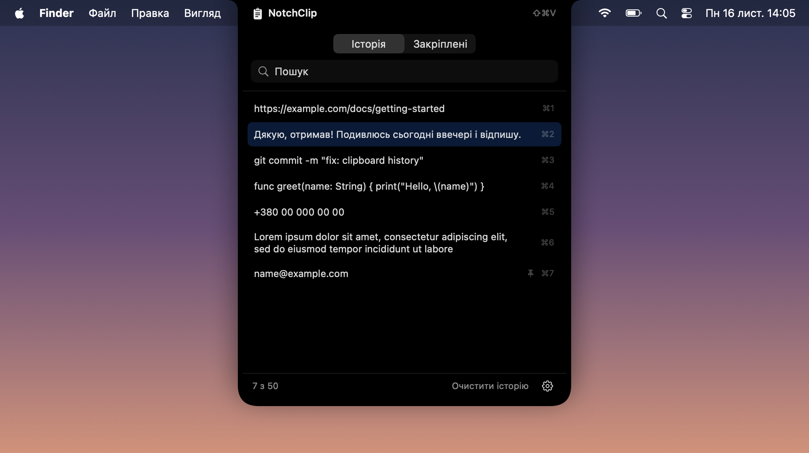
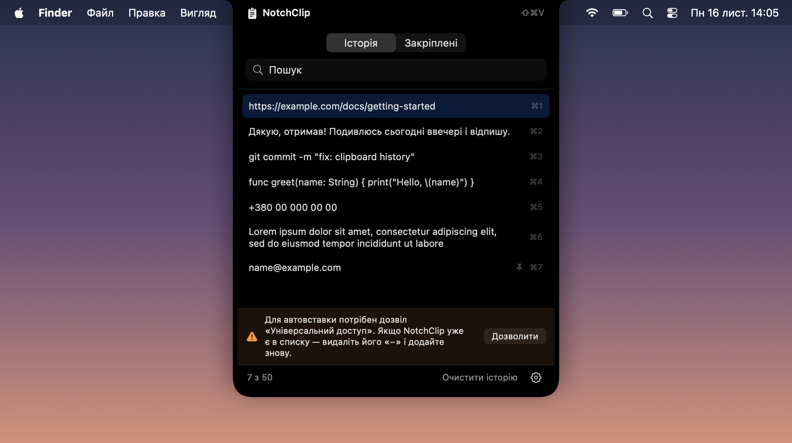
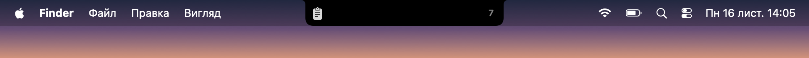
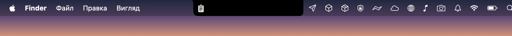
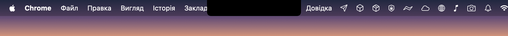
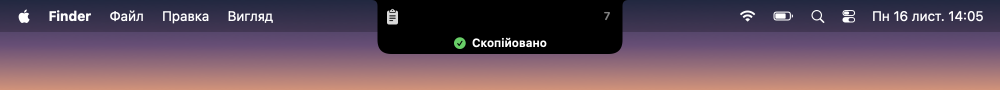
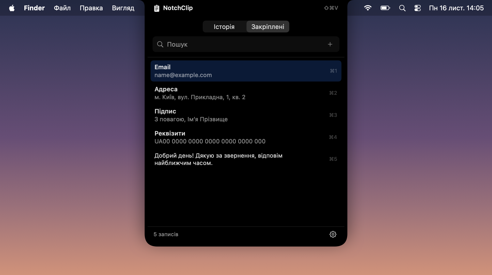
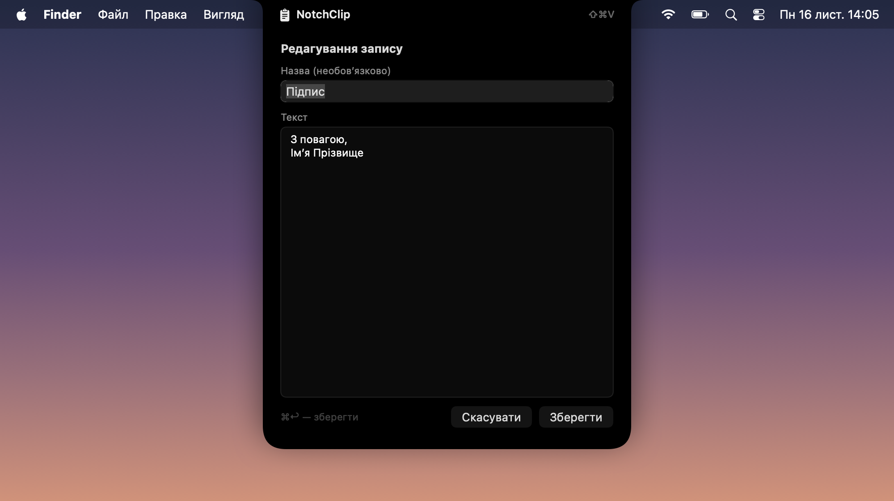

# NotchClip

**Буфер обміну, що живе у вирізі камери MacBook.** Тиснете на виріз — з нього виїжджає панель
з історією скопійованого та вашими постійними записами (email, адреса, підпис, реквізити…).
Клік по запису — і текст одразу вставляється туди, де ви працювали.



---

## Зміст

- [Можливості](#можливості)
- [Вимоги](#вимоги)
- [Встановлення](#встановлення)
- [Перший запуск: дозвіл «Універсальний доступ»](#перший-запуск-дозвіл-універсальний-доступ)
- [Як користуватися](#як-користуватися)
  - [Виріз у спокої](#виріз-у-спокої)
  - [Відкрити панель](#відкрити-панель)
  - [Історія](#історія)
  - [Закріплені (постійні) записи](#закріплені-постійні-записи)
  - [Вставка і копіювання](#вставка-і-копіювання)
  - [Гарячі клавіші](#гарячі-клавіші)
  - [Налаштування](#налаштування)
- [Дані та приватність](#дані-та-приватність)
- [Оновлення і перезбирання](#оновлення-і-перезбирання)
- [Видалення](#видалення)
- [Якщо щось не працює](#якщо-щось-не-працює)
- [Для розробника](#для-розробника)

---

## Можливості

- **Історія буфера**: усе, що ви копіюєте (текст), автоматично потрапляє в список. Без дублікатів: повторно скопійоване піднімається нагору.
- **Закріплені записи**: 10–20 (або скільки завгодно) постійних шаблонів з назвами, які не зникають з історією.
- **Живе у вирізі камери**: біля вирізу маленькі «вушка» з іконкою та лічильником; панель виїжджає прямо з вирізу.
- **Розумні «вушка»**: якщо меню програми (наприклад, Chrome) або іконки в меню-барі підходять впритул до вирізу, «вушка» звужуються чи ховаються, щоб нічого не перекривати.
- **«✓ Скопійовано»**: коли щось копіюєте, виріз на мить «виїжджає» вниз з підтвердженням.
- **Автовставка**: вибраний запис одразу вставляється в активне вікно (як ⌘V).
- **Пошук**, повне керування з клавіатури, **⌘1…⌘9** для перших дев’яти записів.
- **Приватність**: записи, які менеджери паролів позначають як приховані, в історію не потрапляють; файл даних доступний лише вашому користувачу.

---

## Вимоги

| | |
|---|---|
| macOS | 14 Sonoma або новіша |
| Mac | бажано MacBook з вирізом камери. На Mac без вирізу (або зовнішньому моніторі) усе працює, тільки панель відкривається гарячою клавішею чи з іконки в меню-барі |
| Для збирання | Xcode або Command Line Tools (`xcode-select --install`) |

---

## Встановлення

1. Завантажте код і перейдіть у папку:

   ```bash
   git clone https://github.com/F-Andersen/ClipKeep.git && cd ClipKeep
   ```

2. Зберіть і встановіть:

   ```bash
   ./build.sh install
   ```

   Скрипт збере `NotchClip.app`, покладе його в `/Applications` і запустить.
   У Dock його не буде: NotchClip живе біля вирізу камери і (за бажанням) в меню-барі.

> Якщо на Маці є сертифікат **Apple Development** (з’являється, коли ви входите в Xcode зі своїм Apple ID),
> скрипт підпише ним застосунок. Тоді дозвіл «Універсальний доступ» не скидатиметься після кожного перезбирання.
> Без сертифіката застосунок підписується локально (ad-hoc), і дозвіл доведеться видавати заново після кожного `./build.sh`.

Лише зібрати, без встановлення:

```bash
./build.sh
```

Результат буде в `build/NotchClip.app`.

---

## Перший запуск: дозвіл «Універсальний доступ»

NotchClip працює і без дозволу, але тоді він **лише копіює** вибраний запис (вставляти доведеться самому через ⌘V),
а «вушка» біля вирізу не підлаштовуються під меню. Поки дозволу немає, внизу панелі видно жовту смужку:



Як дати дозвіл:

1. Відкрийте панель (клік по вирізу або **⇧⌘V**) і натисніть **«Дозволити»**.
2. Відкриються **Системні налаштування → Конфіденційність і безпека → Універсальний доступ**.
3. Увімкніть перемикач навпроти **NotchClip**. Якщо його немає у списку, натисніть **«+»** і виберіть `/Applications/NotchClip.app`.
4. Жовта смужка зникне сама протягом секунди.

> **Перемикач увімкнений, а смужка не зникає?** Значить, у списку лишився запис від старої збірки.
> Виділіть NotchClip, натисніть **«−»**, потім додайте знову через **«+»**. Або одною командою:
>
> ```bash
> tccutil reset Accessibility local.clipkeep.app
> ```
>
> (`local.clipkeep.app` — внутрішній ідентифікатор, лишився з першої версії, щоб не губилися налаштування.)

Навіщо цей дозвіл:
- щоб натиснути **⌘V** за вас у потрібному вікні (автовставка);
- щоб бачити, де закінчуються меню програм та іконки в меню-барі, і не перекривати їх «вушками».

---

## Як користуватися

### Виріз у спокої

Біля вирізу камери видно чорні «вушка»: зліва іконка буфера, справа кількість записів в історії.



NotchClip постійно стежить, скільки місця вільно в меню-барі, і підлаштовує «вушка»:

| Ситуація | Як виглядає |
|---|---|
| Праворуч від вирізу впритул стоять іконки програм: праве «вушко» ховається |  |
| Меню програми (наприклад, Chrome) займають місце з обох боків: «вушка» ховаються повністю. **Клік по самому вирізу все одно відкриває панель** |  |

Коли ви щось копіюєте, з-під вирізу на мить виїжджає підтвердження. Воно опускається вниз, тож ніколи не перекриває меню:



### Відкрити панель

Будь-який спосіб:

- **клік по вирізу** камери (або по «вушках»);
- **⇧⌘V** у будь-якій програмі;
- клік по іконці NotchClip у меню-барі (якщо вона ввімкнена).

Закрити: **Esc**, клік будь-де поза панеллю, ще раз **⇧⌘V**, або просто виберіть запис.

### Історія

Вкладка **«Історія»** показує останнє скопійоване, від нового до старого.

- Скільки записів зберігати, обирається в налаштуваннях: 20 / 50 / 100 / 200. Найстаріші видаляються автоматично.
- Якщо скопіювати те, що вже є в історії, запис підніметься нагору, а не задублюється.
- Біля записів, які вже є серед закріплених, стоїть маленька 📌.
- **Пошук**: просто почніть друкувати, щойно панель відкрилася. Шукає по тексту і по назвах.
- **«Очистити історію»** внизу видаляє всю історію (закріплені записи не чіпає).

При наведенні на запис з’являються кнопки:
**📌 закріпити / відкріпити** і **🗑 видалити**.

### Закріплені (постійні) записи

Вкладка **«Закріплені»** для того, що вставляєте постійно: email, адреса, підпис, реквізити, шаблони відповідей.
Ці записи не зникають, скільки б ви не копіювали.



**Додати запис:**
- на вкладці «Закріплені» натисніть **«+»** справа в полі пошуку, введіть назву (необов’язково) і текст, потім **«Зберегти»** (або **⌘↩**);
- або в «Історії» наведіть на запис і натисніть **📌** (чи **⌘P** на виділеному). Запис скопіюється в закріплені.



**Редагувати:** наведіть на запис → **✏️**, або правий клік → «Редагувати…».
**Змінити порядок:** правий клік → «Перемістити вгору / вниз». Порядок важливий: перші дев’ять доступні через **⌘1…⌘9**.
**Видалити:** наведіть → **🗑**, правий клік → «Видалити», або **⌘⌫** на виділеному.

> Назва показується жирним над текстом і допомагає швидко знайти запис пошуком («email», «iban»…).
> Вставляється завжди лише **текст**, без назви.

### Вставка і копіювання

| Дія | Що станеться |
|---|---|
| Клік по запису, **↩** або **⌘1…⌘9** | Запис кладеться в буфер, панель закривається, текст **вставляється** у вікно, де ви були |
| **⌥↩** або правий клік → «Лише скопіювати» | Запис кладеться в буфер **без вставки**, далі вставляєте самі через ⌘V |

Якщо автовставку вимкнено в налаштуваннях або немає дозволу «Універсальний доступ», будь-який вибір працює як «Лише скопіювати».

### Гарячі клавіші

**Глобально (в будь-якій програмі):**

| Клавіші | Дія |
|---|---|
| **⇧⌘V** | Відкрити / закрити панель |

**У відкритій панелі:**

| Клавіші | Дія |
|---|---|
| друк тексту | Пошук |
| **↑ / ↓** | Вибрати запис |
| **↩** | Вставити вибраний |
| **⌥↩** | Лише скопіювати вибраний |
| **⌘1 … ⌘9** | Вставити запис №1…9 |
| **⇥ Tab** | Перемкнути «Історія» ⇄ «Закріплені» |
| **⌘P** | Закріпити / відкріпити (в «Історії») |
| **⌘⌫** | Видалити вибраний запис |
| **Esc** | Очистити пошук; ще раз закрити панель |

**У редакторі запису:** **⌘↩** зберегти, **Esc** скасувати.

### Налаштування

Шестерня ⚙︎ у правому нижньому куті панелі:

| Пункт | Що робить |
|---|---|
| **Автовставка в активне вікно** | Увімкнено: вибраний запис одразу вставляється. Вимкнено: лише копіюється |
| **Запускати при вході в систему** | NotchClip стартуватиме автоматично після входу в macOS |
| **Іконка в меню-барі** | Показати / сховати іконку NotchClip у меню-барі (виріз і ⇧⌘V працюють завжди) |
| **Розмір історії** | 20 / 50 / 100 / 200 записів |
| **Вийти з NotchClip** | Повністю закрити застосунок |

Правий клік по іконці в меню-барі теж дає пункти «Відкрити» та «Вийти».

---

## Дані та приватність

- Історія та закріплені записи зберігаються у
  `~/Library/Application Support/NotchClip/data.json`, у звичайному тексті, з правами доступу лише для вашого користувача.
- Нічого нікуди не відправляється: застосунок не ходить в інтернет.
- Записи, які менеджери паролів (наприклад, 1Password) позначають як приховані (`ConcealedType` / `TransientType`), **не зберігаються** в історії. Якщо ваш менеджер паролів таких позначок не ставить, скопійований пароль потрапить в історію, тож видаліть його вручну.
- Зберігається тільки текст. Картинки та файли в історію не потрапляють.
- Якщо скопіювали щось чутливе вручну, видаліть запис (🗑 або **⌘⌫**) чи очистіть історію.

---

## Оновлення і перезбирання

Після змін у коді:

```bash
./build.sh install
```

Скрипт закриє запущену копію, замінить застосунок у `/Applications` і запустить новий.
Історія та закріплені записи зберігаються. При першому запуску після перейменування дані з папки `ClipKeep` переносяться автоматично.

---

## Видалення

1. В налаштуваннях NotchClip вимкніть **«Запускати при вході в систему»** (якщо вмикали).
2. Виконайте:

   ```bash
   pkill -x NotchClip
   ```

   ```bash
   rm -rf /Applications/NotchClip.app
   ```

3. Якщо потрібно стерти й дані, налаштування та дозвіл:

   ```bash
   rm -rf ~/Library/Application\ Support/NotchClip
   ```

   ```bash
   defaults delete local.clipkeep.app
   ```

   ```bash
   tccutil reset Accessibility local.clipkeep.app
   ```

---

## Якщо щось не працює

**Запис лише копіюється, але не вставляється.**
Немає дозволу «Універсальний доступ» або він від старої збірки. Див. [Перший запуск](#перший-запуск-дозвіл-універсальний-доступ): видаліть NotchClip зі списку «−» і додайте знову.

**⇧⌘V нічого не робить.**
Цю комбінацію могла зайняти інша програма (наприклад, інший менеджер буфера на кшталт PasteNow). Закрийте її або змініть їй гарячу клавішу. У деяких редакторах ⇧⌘V означає «вставити без форматування»: поки NotchClip запущений, ця комбінація відкриває його панель.

**Не видно «вушок» біля вирізу.**
Це нормально, коли меню активної програми чи іконки підходять впритул до вирізу: NotchClip ховає «вушка», щоб нічого не перекривати. Клік по самому вирізу все одно відкриває панель.

**«Вушка» перекривають меню.**
Перевірте дозвіл «Універсальний доступ»: без нього NotchClip не бачить меню і показує ліве «вушко» завжди.

**Працюю із зовнішнім монітором / закритою кришкою.**
Виріз є тільки на вбудованому екрані. Відкривайте панель через **⇧⌘V** або іконку в меню-барі: вона з’явиться зверху по центру.

**Після `./build.sh` знову просить дозвіл.**
Немає сертифіката Apple Development, і застосунок підписується ad-hoc. Увійдіть в Xcode → Settings → Accounts зі своїм Apple ID (сертифікат створиться автоматично) або вкажіть свій: `SIGN_ID="назва сертифіката" ./build.sh install`.

---

## Для розробника

Нативний застосунок на Swift + SwiftUI/AppKit, без Xcode-проєкту: збирається одним `swiftc`.

```
build.sh               збирання, підпис, встановлення
Info.plist             метадані застосунку (LSUIElement — без іконки в Dock)
Resources/AppIcon.icns іконка (генерується Tools/make-icon.swift)
Sources/
  main.swift           точка входу (+ режим --snapshot)
  AppDelegate.swift    іконка в меню-барі, ⇧⌘V, обробка клавіш, вставка
  Model.swift          дані: історія, закріплені, налаштування, збереження в JSON
  Clipboard.swift      стеження за буфером, імітація ⌘V, глобальна гаряча клавіша
  Notch.swift          вікно над меню-баром, стани виріз/панель, анімації
  NotchView.swift      форма вирізу, «вушка», «Скопійовано»
  MenuBar.swift        вимір вільного місця в меню-барі через Accessibility
  ContentView.swift    вміст панелі: вкладки, пошук, список, редактор
  Snapshot.swift       рендер скріншотів для README
docs/screenshots/      скріншоти
```

**Змінити гарячу клавішу:** у `Sources/AppDelegate.swift` рядок
`HotKey(keyCode: kVK_ANSI_V, modifiers: cmdKey | shiftKey)`. Наприклад, `kVK_ANSI_C` і `cmdKey | optionKey` дасть ⌥⌘C.

**Оновити скріншоти:** вони рендеряться з того самого коду інтерфейсу на макеті робочого столу:

```bash
./build.sh && ./build/NotchClip.app/Contents/MacOS/NotchClip --snapshot docs/screenshots
```
